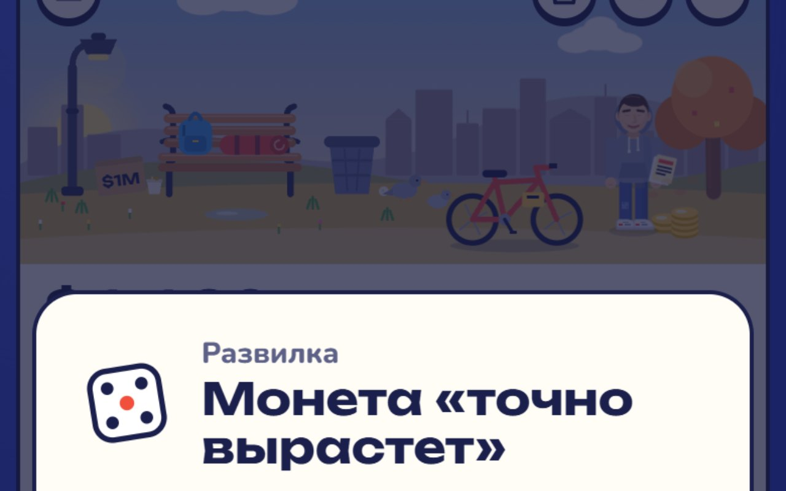

# Zero to Millionaire

[Русская версия](README.ru.md)

An idle game in a single HTML file. A slot machine spins the months of a life, from age 18 to 65 (564 spins), and the goal is to save $1,000,000 before the end. The in-game text is in Russian.



**[Play in the browser](https://antropos17.github.io/zero-to-millionaire/)**

Each spin is one month: salary and passive income arrive. Reel symbols (Work, Study, Health, Connections, Chance, Coin, Bills, Joker) form a deck you can reshape by buying and removing cards. Pairs, triples and fours trigger events. Numbers and rules are in [docs/DESIGN.md](docs/DESIGN.md).

## Run

The built game is `dist/zero-to-millionaire.html`; it opens offline with a double click.

```bash
npm run build     # works without npm install
npm install       # Playwright, tests only
npx playwright install chromium
npm test          # end-to-end checks, about 2 minutes
```

Other scripts: `test:edges`, `test:forks`, `test:fuzz`, `test:monkey`, `test:sweep`, `test:all`, `sim` (balance simulator). See `package.json`.

## Layout

- `src/core.js` – game logic without DOM, runs in browser and Node
- `src/art.js`, `src/ui.js`, `src/template.html`, `src/style.css` – scene art and interface
- `scripts/build.js` – bundles everything with the fonts into one HTML
- `tests/`, `tools/` – tests and balance simulator

## Stack

Plain JavaScript, SVG art, Node build script, Playwright.
